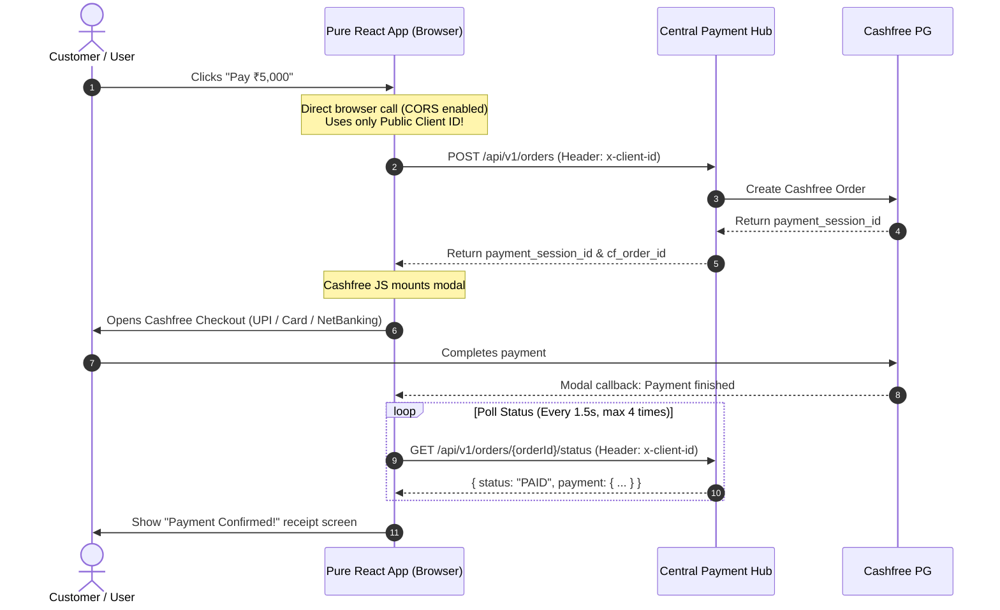

# Universal Client Integration Guide: Pure React (No Supabase, No Backend) & Any Tech Stack

> **Key Rule**: The Central Payment Hub uses Supabase **only internally** for its own ledger. **Client applications are NEVER required to use Supabase, Netlify, or any specific database or cloud provider.**
>
> The Payment Hub is a **100% universal, tech-stack-agnostic REST platform** supporting:
> 1. **Pure React / Frontend SPAs** (Vite, CRA, Next.js, Vue, Angular, Mobile Apps) with **NO backend server and NO Supabase**.
> 2. **Full-Stack Applications** using **ANY language / database** (Node.js, Express, Python/Django/FastAPI, PHP/Laravel, Go, Java, MongoDB, MySQL, PostgreSQL, etc.).

---

## 🤖 One-Shot AI Agent Prompts (Copy & Paste for Automatic Setup)

> **Choose the prompt matching your framework and paste it directly into Cursor, Antigravity, Claude Code, or GitHub Copilot.**
> The AI agent will automatically install `@cashfreepayments/cashfree-js`, generate the hook and checkout component, configure environment variables, and wire up the checkout without asking clarifying questions.

---

### Option A: Next.js One-Shot AI Prompt (App Router / Pages Router)

````text
You are an expert Next.js developer. Integrate Central Payment Hub checkout into this Next.js application by following these instructions step-by-step. Implement all files, install dependencies, and configure environment variables automatically without asking any clarifying questions:

### Step 1: Install Cashfree SDK
Run this command in the project terminal:
npm install @cashfreepayments/cashfree-js

### Step 2: Configure Environment Variables
Add the following configuration to the application's ".env.local" file:
# Central Payment Hub Client Configuration
# (Replace <YOUR_PUBLIC_CLIENT_ID> with your registered Client ID from Central Payment Hub /apps)
NEXT_PUBLIC_PAYMENT_HUB_URL="http://localhost:3000/api/v1"
NEXT_PUBLIC_PAYMENT_HUB_CLIENT_ID="<YOUR_PUBLIC_CLIENT_ID>"

### Step 3: Create Hook (hooks/usePaymentHub.ts)
Create the file `hooks/usePaymentHub.ts` (or `src/hooks/usePaymentHub.ts`):
```typescript
"use client";

import { useState } from "react";
import { load } from "@cashfreepayments/cashfree-js";

export interface InitiatePaymentParams {
  orderId?: string;
  amount: number;
  customerPhone: string;
  customerName?: string;
  customerEmail?: string;
  orderNote?: string;
  onSuccess?: (paymentId: string) => void;
  onFailure?: (error: string) => void;
}

export function usePaymentHub() {
  const [loading, setLoading] = useState(false);
  const [error, setError] = useState<string | null>(null);

  const pay = async ({
    orderId = `ORD_${Date.now()}_${Math.floor(Math.random() * 1000)}`,
    amount,
    customerPhone,
    customerName = "Valued Customer",
    customerEmail = "customer@example.com",
    orderNote = "Web Order",
    onSuccess,
    onFailure,
  }: InitiatePaymentParams) => {
    setLoading(true);
    setError(null);

    // Dynamic URL and Client ID (Supports both Next.js and Vite)
    const hubUrl =
      (typeof process !== "undefined" && process.env?.NEXT_PUBLIC_PAYMENT_HUB_URL) ||
      (typeof import.meta !== "undefined" && (import.meta as any).env?.VITE_PAYMENT_HUB_URL) ||
      "http://localhost:3000/api/v1";

    const clientId =
      (typeof process !== "undefined" && process.env?.NEXT_PUBLIC_PAYMENT_HUB_CLIENT_ID) ||
      (typeof import.meta !== "undefined" && (import.meta as any).env?.VITE_PAYMENT_HUB_CLIENT_ID) ||
      "";

    try {
      // 1. Direct browser call to Central Payment Hub (CORS is enabled)
      const res = await fetch(`${hubUrl}/orders`, {
        method: "POST",
        headers: {
          "Content-Type": "application/json",
          "x-client-id": clientId,
        },
        body: JSON.stringify({
          order_id: orderId,
          order_amount: Number(amount),
          order_currency: "INR",
          customer_details: {
            customer_id: `CUST_${customerPhone}`,
            customer_phone: customerPhone,
            customer_name: customerName,
            customer_email: customerEmail,
          },
          order_note: orderNote,
        }),
      });

      const data = await res.json();
      if (!res.ok || !data.success) {
        throw new Error(data.error || "Failed to create payment session");
      }

      const paymentSessionId = data.payment_session_id || data.order?.paymentSessionId;
      if (!paymentSessionId) {
        throw new Error("Missing paymentSessionId from payment hub response");
      }

      // 2. Load Cashfree Checkout Modal SDK
      const isProd =
        (typeof process !== "undefined" && process.env?.NODE_ENV === "production") ||
        (typeof import.meta !== "undefined" && (import.meta as any).env?.PROD);

      const cashfree = await load({
        mode: isProd ? "production" : "sandbox",
      });

      // 3. Mount Drop-in Modal
      const checkoutResult = await cashfree.checkout({
        paymentSessionId: paymentSessionId,
        redirectTarget: "_modal",
      });

      if (checkoutResult.error) {
        throw new Error(checkoutResult.error.message || "Payment cancelled");
      }

      // 4. Poll payment status to confirm
      pollPaymentStatus(orderId, hubUrl, clientId, onSuccess, onFailure);
    } catch (err: any) {
      setError(err.message || "Payment failed to launch");
      if (onFailure) onFailure(err.message);
    } finally {
      setLoading(false);
    }
  };

  const pollPaymentStatus = (
    orderId: string,
    hubUrl: string,
    clientId: string,
    onSuccess?: (id: string) => void,
    onFailure?: (err: string) => void
  ) => {
    let attempts = 0;
    const interval = setInterval(async () => {
      attempts++;
      try {
        const res = await fetch(`${hubUrl}/orders/${orderId}/status`, {
          headers: { "x-client-id": clientId },
        });
        const data = await res.json();

        if (data.status === "PAID") {
          clearInterval(interval);
          if (onSuccess) onSuccess(data.latest_payment?.cfPaymentId || "CONFIRMED");
        } else if (attempts >= 6) {
          clearInterval(interval);
          if (onSuccess) onSuccess("PENDING_VERIFICATION");
        }
      } catch (err: any) {
        clearInterval(interval);
        if (onFailure) onFailure("Status polling failed");
      }
    }, 1500);
  };

  return { pay, loading, error };
}
```

### Step 4: Create Component (components/CheckoutButton.tsx)
Create `components/CheckoutButton.tsx` (or `src/components/CheckoutButton.tsx`):
```tsx
"use client";

import React, { useState } from "react";
import { usePaymentHub } from "@/hooks/usePaymentHub";

interface CheckoutButtonProps {
  amount: number;
  customerPhone?: string;
  customerName?: string;
  customerEmail?: string;
  orderNote?: string;
  onSuccess?: (paymentId: string) => void;
  className?: string;
}

export function CheckoutButton({
  amount,
  customerPhone = "9876543210",
  customerName = "Customer",
  customerEmail = "customer@example.com",
  orderNote = "Web Order Payment",
  onSuccess,
  className,
}: CheckoutButtonProps) {
  const { pay, loading, error } = usePaymentHub();
  const [receipt, setReceipt] = useState<string | null>(null);

  const handleCheckout = () => {
    setReceipt(null);
    pay({
      amount,
      customerPhone,
      customerName,
      customerEmail,
      orderNote,
      onSuccess: (paymentId) => {
        setReceipt(`🎉 Payment Confirmed! Ref ID: ${paymentId}`);
        if (onSuccess) onSuccess(paymentId);
      },
      onFailure: (err) => {
        console.error("Payment failed:", err);
      },
    });
  };

  return (
    <div className="space-y-2">
      <button
        onClick={handleCheckout}
        disabled={loading}
        className={
          className ||
          "w-full py-3 px-6 rounded-xl bg-blue-600 hover:bg-blue-500 disabled:opacity-50 text-white font-bold transition shadow-md cursor-pointer"
        }
      >
        {loading ? "Opening Cashfree..." : `Pay ₹${amount} with Cashfree`}
      </button>

      {receipt && (
        <div className="p-3 rounded-lg bg-emerald-500/10 border border-emerald-500/20 text-emerald-400 text-xs font-medium">
          {receipt}
        </div>
      )}

      {error && (
        <div className="p-3 rounded-lg bg-rose-500/10 border border-rose-500/20 text-rose-400 text-xs font-medium">
          ❌ {error}
        </div>
      )}
    </div>
  );
}
```

### Step 5: Integration & Rules
- Do NOT ask for clientSecret, database connection strings, or backend credentials (browser client uses only NEXT_PUBLIC_PAYMENT_HUB_CLIENT_ID).
- Locate the main pricing, checkout, or cart page in this Next.js app and wire `<CheckoutButton amount={...} />` into it.
````

---

### Option B: Pure React One-Shot AI Prompt (Vite / CRA / SPA)

````text
You are an expert React frontend developer. Integrate Central Payment Hub checkout into this React application by following these instructions step-by-step. Implement all files, install dependencies, and configure environment variables automatically without asking any clarifying questions:

### Step 1: Install Cashfree SDK
Run this command in the project terminal:
npm install @cashfreepayments/cashfree-js

### Step 2: Configure Environment Variables
Add the following configuration to the application's ".env" file:
# Central Payment Hub Client Configuration (Vite & CRA)
# (Replace <YOUR_PUBLIC_CLIENT_ID> with your registered Client ID from Central Payment Hub /apps)
VITE_PAYMENT_HUB_URL="http://localhost:3000/api/v1"
VITE_PAYMENT_HUB_CLIENT_ID="<YOUR_PUBLIC_CLIENT_ID>"

# For Create-React-App (CRA):
REACT_APP_PAYMENT_HUB_URL="http://localhost:3000/api/v1"
REACT_APP_PAYMENT_HUB_CLIENT_ID="<YOUR_PUBLIC_CLIENT_ID>"

### Step 3: Create React Hook (src/hooks/usePaymentHub.ts)
Create the file "src/hooks/usePaymentHub.ts":
```typescript
import { useState } from "react";
import { load } from "@cashfreepayments/cashfree-js";

export interface InitiatePaymentParams {
  orderId?: string;
  amount: number;
  customerPhone?: string;
  customerName?: string;
  customerEmail?: string;
  orderNote?: string;
  onSuccess?: (paymentId: string) => void;
  onFailure?: (error: string) => void;
}

export function usePaymentHub() {
  const [loading, setLoading] = useState(false);
  const [error, setError] = useState<string | null>(null);

  const pay = async ({
    orderId = `ORD_${Date.now()}_${Math.floor(Math.random() * 1000)}`,
    amount,
    customerPhone = "9876543210",
    customerName = "Valued Customer",
    customerEmail = "customer@example.com",
    orderNote = "React Store Checkout",
    onSuccess,
    onFailure,
  }: InitiatePaymentParams) => {
    setLoading(true);
    setError(null);

    // Read Vite or CRA environment variables
    const hubUrl =
      (typeof import.meta !== "undefined" && (import.meta as any).env?.VITE_PAYMENT_HUB_URL) ||
      (typeof process !== "undefined" && process.env?.REACT_APP_PAYMENT_HUB_URL) ||
      "http://localhost:3000/api/v1";

    const clientId =
      (typeof import.meta !== "undefined" && (import.meta as any).env?.VITE_PAYMENT_HUB_CLIENT_ID) ||
      (typeof process !== "undefined" && process.env?.REACT_APP_PAYMENT_HUB_CLIENT_ID) ||
      "";

    try {
      // 1. Direct browser call to Central Payment Hub (CORS is enabled)
      const res = await fetch(`${hubUrl}/orders`, {
        method: "POST",
        headers: {
          "Content-Type": "application/json",
          "x-client-id": clientId,
        },
        body: JSON.stringify({
          order_id: orderId,
          order_amount: Number(amount),
          order_currency: "INR",
          customer_details: {
            customer_id: `CUST_${customerPhone}`,
            customer_phone: customerPhone,
            customer_name: customerName,
            customer_email: customerEmail,
          },
          order_note: orderNote,
        }),
      });

      const data = await res.json();
      if (!res.ok || !data.success) {
        throw new Error(data.error || "Failed to create payment session");
      }

      const paymentSessionId = data.payment_session_id || data.order?.paymentSessionId;
      if (!paymentSessionId) {
        throw new Error("Missing paymentSessionId from payment hub response");
      }

      // 2. Load Cashfree Checkout Modal SDK
      const isProd =
        (typeof import.meta !== "undefined" && (import.meta as any).env?.PROD) ||
        (typeof process !== "undefined" && process.env?.NODE_ENV === "production");

      const cashfree = await load({
        mode: isProd ? "production" : "sandbox",
      });

      // 3. Mount Drop-in Modal
      const checkoutResult = await cashfree.checkout({
        paymentSessionId: paymentSessionId,
        redirectTarget: "_modal",
      });

      if (checkoutResult.error) {
        throw new Error(checkoutResult.error.message || "Payment cancelled");
      }

      // 4. Poll payment status to confirm
      pollPaymentStatus(orderId, hubUrl, clientId, onSuccess, onFailure);
    } catch (err: any) {
      setError(err.message || "Payment failed to launch");
      if (onFailure) onFailure(err.message);
    } finally {
      setLoading(false);
    }
  };

  const pollPaymentStatus = (
    orderId: string,
    hubUrl: string,
    clientId: string,
    onSuccess?: (id: string) => void,
    onFailure?: (err: string) => void
  ) => {
    let attempts = 0;
    const interval = setInterval(async () => {
      attempts++;
      try {
        const res = await fetch(`${hubUrl}/orders/${orderId}/status`, {
          headers: { "x-client-id": clientId },
        });
        const data = await res.json();

        if (data.status === "PAID") {
          clearInterval(interval);
          if (onSuccess) onSuccess(data.latest_payment?.cfPaymentId || "CONFIRMED");
        } else if (attempts >= 6) {
          clearInterval(interval);
          if (onSuccess) onSuccess("PENDING_VERIFICATION");
        }
      } catch (err: any) {
        clearInterval(interval);
        if (onFailure) onFailure("Status polling failed");
      }
    }, 1500);
  };

  return { pay, loading, error };
}
```

### Step 4: Create React Component (src/components/CheckoutButton.tsx)
Create the file "src/components/CheckoutButton.tsx":
```tsx
import React, { useState } from "react";
import { usePaymentHub } from "../hooks/usePaymentHub";

interface CheckoutButtonProps {
  amount: number;
  customerPhone?: string;
  customerName?: string;
  customerEmail?: string;
  orderNote?: string;
  onSuccess?: (paymentId: string) => void;
  className?: string;
}

export function CheckoutButton({
  amount,
  customerPhone = "9876543210",
  customerName = "Customer",
  customerEmail = "customer@example.com",
  orderNote = "React App Checkout",
  onSuccess,
  className,
}: CheckoutButtonProps) {
  const { pay, loading, error } = usePaymentHub();
  const [receipt, setReceipt] = useState<string | null>(null);

  const handleCheckout = () => {
    setReceipt(null);
    pay({
      amount,
      customerPhone,
      customerName,
      customerEmail,
      orderNote,
      onSuccess: (paymentId) => {
        setReceipt(`🎉 Payment Confirmed! Ref ID: ${paymentId}`);
        if (onSuccess) onSuccess(paymentId);
      },
      onFailure: (err) => {
        console.error("Payment failed:", err);
      },
    });
  };

  return (
    <div className="space-y-2">
      <button
        onClick={handleCheckout}
        disabled={loading}
        className={
          className ||
          "w-full py-3 px-6 rounded-xl bg-cyan-500 hover:bg-cyan-400 disabled:opacity-50 text-slate-950 font-bold transition shadow-md cursor-pointer"
        }
      >
        {loading ? "Opening Cashfree..." : `Pay ₹${amount} with Cashfree`}
      </button>

      {receipt && (
        <div className="p-3 rounded-lg bg-emerald-500/10 border border-emerald-500/20 text-emerald-400 text-xs font-medium">
          {receipt}
        </div>
      )}

      {error && (
        <div className="p-3 rounded-lg bg-rose-500/10 border border-rose-500/20 text-rose-400 text-xs font-medium">
          ❌ {error}
        </div>
      )}
    </div>
  );
}
```

### Step 5: Integration & Rules
- Do NOT ask for backend server routes, backend database credentials, or secret keys (zero-backend browser integration).
- Wire `<CheckoutButton amount={...} />` into the main checkout or pricing component.
````

---

## Pattern 1: Pure React Frontend (Zero-Backend, No Supabase)

If your application is a **pure React frontend** (e.g., built with Vite, Create React App, or hosted on S3/Vercel/GitHub Pages):

### How it works:
1. You register your React app in the Payment Hub and get a **Public Client ID** (`pub_live_react_app_xxxx`).
2. Your React app calls the Payment Hub's `POST /api/v1/orders` **directly from the browser using only `x-client-id`** (The Payment Hub has built-in CORS enabled).
3. The Payment Hub returns the Cashfree `payment_session_id`.
4. Your React app launches Cashfree's drop-in modal checkout (`@cashfreepayments/cashfree-js`).
5. Once the modal closes, your React app polls the lightweight `GET /api/v1/orders/{orderId}/status` endpoint using `x-client-id` to display the success confirmation.



---

### Pure React Implementation (Copy-Paste Ready)

#### Step 1: Install Cashfree SDK in your React Project
```bash
npm install @cashfreepayments/cashfree-js
```

#### Step 2: Add your Public Client ID to your React `.env`
In your React app `.env` (or `.env.local`):
```env
# Pure React Frontend .env (Vite or CRA)
VITE_PAYMENT_HUB_URL="http://localhost:3000/api/v1" # or your deployed Payment Hub URL
VITE_PAYMENT_HUB_CLIENT_ID="pub_live_my_react_app_xxxx"
```

#### Step 3: Create the React Payment Hook (`src/usePaymentHub.ts`)

```typescript
// src/usePaymentHub.ts
import { useState } from "react";
import { load } from "@cashfreepayments/cashfree-js";

interface InitiatePaymentParams {
  orderId: string;
  amount: number;
  customerPhone: string;
  customerName?: string;
  customerEmail?: string;
  onSuccess: (paymentId: string) => void;
  onFailure: (error: string) => void;
}

export function usePaymentHub() {
  const [loading, setLoading] = useState(false);

  const pay = async ({
    orderId,
    amount,
    customerPhone,
    customerName,
    customerEmail,
    onSuccess,
    onFailure,
  }: InitiatePaymentParams) => {
    setLoading(true);
    const hubUrl = import.meta.env.VITE_PAYMENT_HUB_URL || "http://localhost:3000/api/v1";
    const clientId = import.meta.env.VITE_PAYMENT_HUB_CLIENT_ID;

    try {
      // 1. Direct browser call to Central Payment Hub (CORS enabled)
      const response = await fetch(`${hubUrl}/orders`, {
        method: "POST",
        headers: {
          "Content-Type": "application/json",
          "x-client-id": clientId,
        },
        body: JSON.stringify({
          order_id: orderId,
          order_amount: amount,
          order_currency: "INR",
          customer_details: {
            customer_id: `CUST_${customerPhone}`,
            customer_phone: customerPhone,
            customer_name: customerName || "Customer",
            customer_email: customerEmail || "customer@example.com",
          },
          order_note: "React Web Store Order",
        }),
      });

      const orderData = await response.json();
      if (!orderData.payment_session_id) {
        throw new Error(orderData.error || "Failed to initiate payment session");
      }

      // 2. Load Cashfree Checkout Modal
      const cashfree = await load({
        mode: import.meta.env.PROD ? "production" : "sandbox",
      });

      // 3. Mount Drop-in Modal (User never leaves your React app)
      const checkoutResult = await cashfree.checkout({
        paymentSessionId: orderData.payment_session_id,
        redirectTarget: "_modal",
      });

      if (checkoutResult.error) {
        onFailure(checkoutResult.error.message || "Payment cancelled by user");
        return;
      }

      // 4. Poll status to confirm payment
      pollPaymentStatus(orderId, hubUrl, clientId, onSuccess, onFailure);
    } catch (err: any) {
      onFailure(err.message || "Network error launching payment");
    } finally {
      setLoading(false);
    }
  };

  const pollPaymentStatus = (
    orderId: string,
    hubUrl: string,
    clientId: string,
    onSuccess: (id: string) => void,
    onFailure: (err: string) => void
  ) => {
    let attempts = 0;
    const interval = setInterval(async () => {
      attempts++;
      try {
        const res = await fetch(`${hubUrl}/orders/${orderId}/status`, {
          headers: { "x-client-id": clientId },
        });
        const data = await res.json();

        if (data.status === "PAID") {
          clearInterval(interval);
          onSuccess(data.latest_payment?.cfPaymentId || "CONFIRMED");
        } else if (attempts >= 6) {
          clearInterval(interval);
          onSuccess("PENDING_VERIFICATION");
        }
      } catch (e) {
        clearInterval(interval);
        onFailure("Failed to check status");
      }
    }, 1500);
  };

  return { pay, loading };
}
```

#### Step 4: Use in your React Component (`src/CheckoutPage.tsx`)

```tsx
// src/CheckoutPage.tsx
import React, { useState } from "react";
import { usePaymentHub } from "./usePaymentHub";

export function CheckoutPage() {
  const { pay, loading } = usePaymentHub();
  const [result, setResult] = useState<string | null>(null);

  const handleCheckout = () => {
    setResult(null);
    pay({
      orderId: `ORD_${Date.now()}`,
      amount: 4999.00,
      customerPhone: "9876543210",
      customerName: "Priya Sharma",
      customerEmail: "priya@example.com",
      onSuccess: (paymentId) => {
        setResult(`🎉 Payment Successful! Reference ID: ${paymentId}`);
      },
      onFailure: (errorMsg) => {
        setResult(`❌ ${errorMsg}`);
      },
    });
  };

  return (
    <div style={{ padding: "2rem", fontFamily: "sans-serif" }}>
      <h2>Checkout: Annual Subscription</h2>
      <p>Amount: <strong>₹4,999.00</strong></p>

      <button
        onClick={handleCheckout}
        disabled={loading}
        style={{
          padding: "12px 24px",
          backgroundColor: "#16a34a",
          color: "#fff",
          border: "none",
          borderRadius: "8px",
          fontWeight: "bold",
          cursor: "pointer",
        }}
      >
        {loading ? "Opening Cashfree..." : "Pay ₹4,999 with Cashfree"}
      </button>

      {result && <p style={{ marginTop: "1rem" }}>{result}</p>}
    </div>
  );
}
```

---

## Pattern 2: Application with ANY Custom Backend (Python, PHP, Node, Go, Java, etc.)

If your application has its own backend server and its own database (**MongoDB, MySQL, PostgreSQL, Firebase, etc.**):

### 1. Backend Order Initiation
Your backend makes a standard server-to-server HTTP request:
```bash
POST /api/v1/orders
Headers:
  x-client-id: <YOUR_CLIENT_ID>
  x-client-secret: <YOUR_CLIENT_SECRET>
Body:
  {
    "order_id": "YOUR_INTERNAL_ID",
    "order_amount": 1000.00,
    "customer_details": {
      "customer_id": "USER_123",
      "customer_phone": "9999999999"
    }
  }
```
Returns:
```json
{
  "payment_session_id": "session_xxxx",
  "cf_order_id": "YOURAPP_YOUR_INTERNAL_ID"
}
```

### 2. Webhook Delivery to your Backend
The Payment Hub verifies Cashfree's signature, validates the status, and posts the verified result to **your backend's webhook endpoint**:
```
POST https://yourapp.com/api/payment-webhook
Headers:
  x-hub-signature: <HMAC-SHA256 signature>
Body:
  {
    "event_type": "PAYMENT.SUCCESS",
    "order_id": "YOUR_INTERNAL_ID",
    "amount": 1000.00,
    "payment_id": "CF_PAY_991823"
  }
```
Your backend verifies `x-hub-signature` using your `webhookSecret` and updates your database (MySQL, MongoDB, Firebase, etc.) — **completely independent of Supabase**.

---

## Summary

| Technology | Needs Supabase? | Needs Backend Server? | How it connects |
| :--- | :---: | :---: | :--- |
| **Pure React SPA** (Vite / CRA) | ❌ **No** | ❌ **No** | Directly from browser via `x-client-id` + Cashfree modal |
| **Node.js / Express** | ❌ **No** | ✅ Yes | Server-to-server HTTP + webhook |
| **Python (Django / FastAPI)** | ❌ **No** | ✅ Yes | Server-to-server HTTP + webhook |
| **PHP / Laravel** | ❌ **No** | ✅ Yes | Server-to-server HTTP + webhook |
| **Android / iOS App** | ❌ **No** | ❌ **No** | Direct via `x-client-id` + Cashfree Mobile SDK |
| **Real Estate CRM** | ✅ (uses its own DB) | ✅ Yes | Via Next.js Route Handlers + Supabase |
